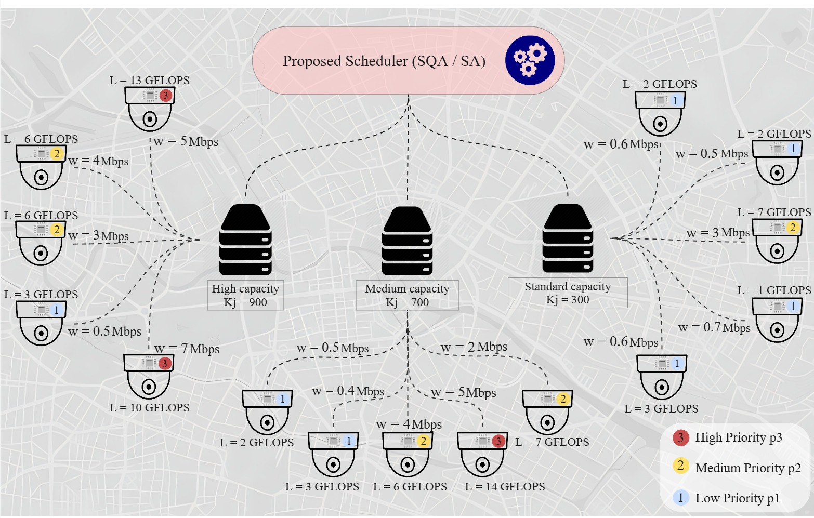

# Quantum-Sensor-Assignment

[](https://www.python.org/)
[](https://www.openjij.org/)
[](https://dwave-neal-docs.readthedocs.io/)
[](https://scipy.org/)
[](LICENSE)

**Price-coordinated decomposition with compact QUBO subproblems** for the sequential assignment of video sensors (cameras) to capacitated edge servers.

Cameras arrive in batches, and every decision is final. The batches are coordinated by Lagrangian capacity prices, which are recomputed on the residual problem with a 5% demand margin. Each batch is a small assignment problem. It can be solved exactly, greedily, or as a compact QUBO sampled by simulated (quantum) annealing.

The repository contains the code, the raw logs of every experiment and the scripts that rebuild every table and figure.

| Document | Content |
|---|---|
| [`docs/METHODOLOGY.md`](docs/METHODOLOGY.md) | the problem, a QUBO primer, the coordination layer (prices, re-pricing, demand margin), the QUBO-v3.1 encoding with proofs, the baselines |
| [`docs/METRICS.md`](docs/METRICS.md) | definition of every metric and statistical test, and which script computes it |
| [`docs/EXPERIMENTS.md`](docs/EXPERIMENTS.md) | every experiment: command, data folder, summary script and results |

## Problem in one paragraph

$N$ cameras (default 20,000) with priority $p_i\in\{1,2,3\}$ and load $l_i$ are assigned to $M$ edge servers (default 800) with capacities $K_j$. The objective is

$$\min\ \sum_{ij} w_i c_{ij} x_{ij} + P\cdot\#\text{uncovered},$$

where $c_{ij}$ is a normalised cost made of distance, load, priority and server size, $w_i=4-p_i$, and $P=15$. It is a generalised assignment problem with optional coverage, solved under sequential, irrevocable batch decisions at 75–98% utilisation. All numbers below are gaps to a Lagrangian lower bound of the same instance.



## Main results

20,000 × 800, test seeds 42–51, exact batch solver. Gap to the Lagrangian lower bound:

| Decomposition / coordination | 75% | 90% | 95% | 98% |
|---|---|---|---|---|
| Shared 80×20 window (first version) | 102% | 94% | 90% | 87% |
| Per-camera window, static prices | 4.33% | 8.55% | 11.85% | 16.48% |
| + residual re-pricing every 5 batches | 0.45% | 1.03% | 1.64% | 3.35% |
| **+ 5% demand margin** | **0.29%** | **0.61%** | **0.89%** | **1.16%** |
| Demand statistics only + 5% margin | 0.93% | 1.47% | 1.83% | 2.51% |
| Offline solution (sees everything, may revise) | 0.29% | 0.57% | 0.74% | 1.03% |

- **The coordination layer, not the batch solver, determines quality.** Under the same coordination, exact MILP, greedy, regret, ILS, SA and SQA with local search end within 0.12 pp of each other. Pure SQA, without local search, is up to 0.15 pp behind the best solver.
- **Comparison with online-allocation baselines.** The proposed prices are within 0.2 pp of exact LP bid prices with the same margin, at 1/8–1/17 of the run time. Dual mirror descent (6–22%) and a 2-batch rolling-horizon MILP (27–46%) are far worse.
- **Robustness.** The results hold on a clustered city layout and at 50,000 × 2,000. They also hold under the alternative weight $w_i=p_i$ (a full repeat study of 950 runs): the 5% margin is again best on the validation seeds and improves re-pricing on 9–10 of 10 test seeds. One difference: under this weight, exact LP prices *without* a margin beat ours at 90–95%, while LP prices *with* the margin break down at 98%. The Lagrangian prices with the margin stay stable under both weights.
- **The QUBO side.** After an exact reduction the median batch QUBO has 14 variables, and the size does not grow with $N$ or $M$. Domain-wall encoding removes the one-hot energy barriers. On classical hardware SQA is **not** better than exact batch optimisation, ILS or SA, and pure SQA is slightly weaker than they are. With local search it reaches batch optimality. The QUBO is offered as a compact, provably well-formed subproblem for Ising hardware, not as a source of speed-up.

Details, paired tests and all other experiments are in [`docs/EXPERIMENTS.md`](docs/EXPERIMENTS.md).

## Repository layout

```
qsa/                              method and evaluation code
  capacity_stress_experiment.py   seeded instance generator; first-generation QUBOs (AO, Static-QCP, PRC)
  batch_quality_benchmark.py      instances (uniform / clustered), batch subproblems, exact MILP (HiGHS), greedy, regret, LS
  v3_trajectory.py                one full sequential run: coordination layer + batch solver (main entry point)
  online_baselines.py             LP bid prices, dual mirror descent, rolling-horizon MILP
  qubo_v3_lab.py                  encoding ablation on hard batches (gap to the batch optimum)
  global_bound_check.py           Lagrangian lower bound and offline solution
  offline_global.py               offline solution with full assignment (service metrics)
  lb_prio.py                      lower bounds for w = p and for validation seeds
  service_metrics.py              price of sequentiality, service by priority class, server saturation
  *_aggregate.py, r2_tables.py    tables with paired statistics
  make_figures.py                 every figure of the paper (PDF + PNG)
  aa_proto.py                     pairwise anti-affinity extension
experiments/                      job lists of all campaigns (+ .done files) and the resumable runner run_jobs.py
results/v3/                       raw logs (JSON) of every experiment, one folder per experiment
baselines/                        GRASP, BRKGA, tabu search, capacity-priced greedy (first-generation setting)
legacy/                           first-generation formulations, first-submission pipeline and logs
docs/                             METHODOLOGY.md, METRICS.md, EXPERIMENTS.md, img/
```

## Installation

Use Python 3.10 in a clean virtual environment.

```bash
python3.10 -m venv .venv          # Windows: py -3.10 -m venv .venv
source .venv/bin/activate         # Windows: .\.venv\Scripts\activate
python -m pip install --upgrade pip setuptools wheel
python -m pip install -r requirements.txt
python -c "import openjij as oj, neal, scipy; print(oj.__version__, scipy.__version__)"
```

The pinned versions are NumPy 1.24.3, SciPy 1.10.1, OpenJij 0.11.6, dwave-neal 0.5.7 and dimod 0.12.6. All experiments run on ordinary CPUs: no quantum processor and no GPU code path is used.

**OpenJij parameters.** `SQASampler()` takes no constructor arguments in OpenJij 0.11.x. `num_reads`, `num_sweeps`, `trotter`, `beta` and `gamma` must be passed to `sample_qubo()`:

```python
import openjij as oj
response = oj.SQASampler().sample_qubo(Q, num_reads=10, num_sweeps=2000, trotter=8, beta=20.0, gamma=1.0, seed=42)
```

Code that passes them to the constructor and falls back to `SQASampler()` on `TypeError` silently runs 1 read, 4 Trotter slices and 1000 sweeps. The first submission was affected (see below). **Every result in `docs/` and `results/v3/` was produced with the corrected call:** campaign 2 and all later experiments, October 2026.

## Reproducing the results

```bash
# one sequential run: exact batches, re-pricing every 5 batches, 5% demand margin, 95% utilisation
python qsa/v3_trajectory.py --method exact --target-util 95 --seed 42 \
       --price --price-window --reprice 5 --k-slack 2 --forecast-bias 0.05 --out results/example

# the same with the QUBO solved by SQA and polished by local search
python qsa/v3_trajectory.py --method sqa_v3 --polish --target-util 95 --seed 42 \
       --price --price-window --reprice 5 --k-slack 2 --forecast-bias 0.05 --out results/example

# a whole experiment from its job list (resumable)
python experiments/run_jobs.py experiments/jobs_test_margin05.txt --workers 4

# all figures from the archived logs
python qsa/make_figures.py --repo . --out figures
```

The job list, data folder and summary script of every experiment are listed in [`docs/EXPERIMENTS.md`](docs/EXPERIMENTS.md).

## Earlier versions

The first submission (folder `legacy/`, description in `legacy/README_legacy.md`) used PRC-QUBO with a shared window of 20 servers per batch. Its results should not be reused:

- The reported objective of about 7,108 includes a global local-search refinement (`final_opt`). The same refinement gives 7,108.3 for plain greedy.
- SQA ran with the OpenJij defaults (1 read, 4 Trotter slices) because of the constructor issue above. The reported SQA/SA speed ratio therefore compares 1 read with 50–150 reads.
- The 99.6% coverage figure comes from the 99.5% early-stop rule, not from the solver.
- The one-hot penalty (15) is smaller than the assignment reward (up to 75). Raw samples therefore select about three servers per camera, and the decoder makes the assignment. Proposition 1 in `docs/METHODOLOGY.md` explains why.
- The shared window itself leaves even exact batch optimisation 87–102% above the lower bound.

## Citation

```bibtex
@misc{mussabayev2026qsa,
  title  = {Quantum-Sensor-Assignment: price-coordinated decomposition with compact QUBO subproblems
            for sequential sensor-to-edge-server assignment},
  author = {Yedige Mussabayev},
  year   = {2026},
  url    = {https://github.com/Yedman3585/Quantum-Sensor-Assignment}
}
```

## License and acknowledgments

Released under the [MIT License](LICENSE).

The research and software development were led by Yedige Mussabayev. Scientific supervision and methodological guidance were provided by Artem Bykov. Additional scientific review and recommendations were provided by Evgeniy Lavrov.
